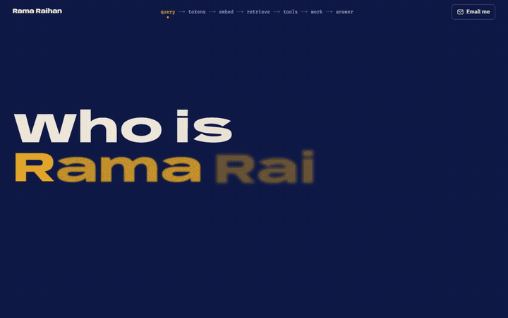
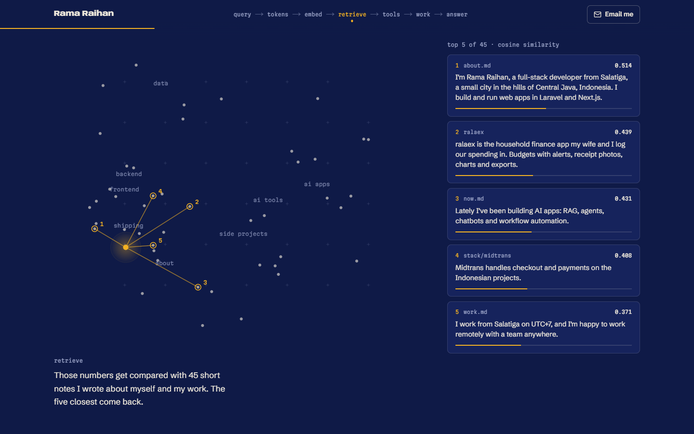
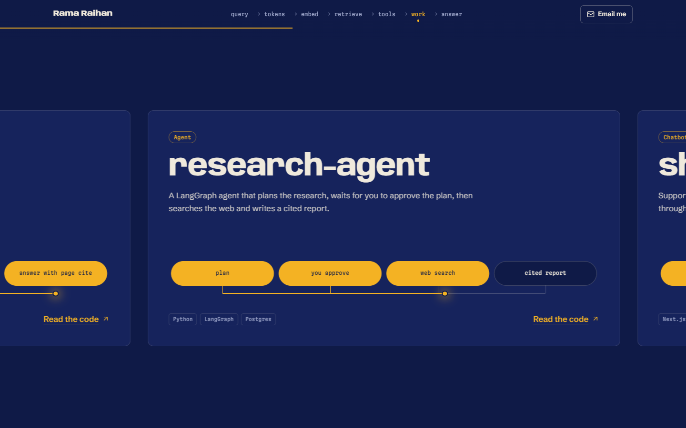
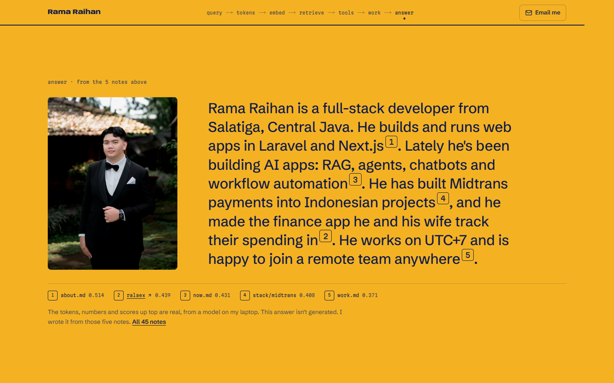
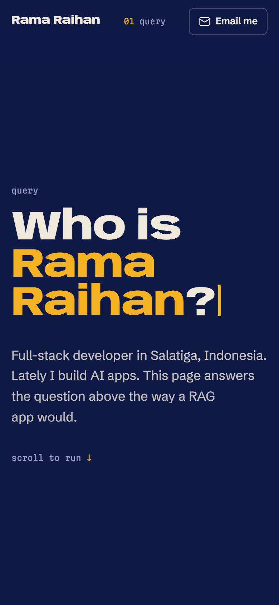

# ramaraihan12.github.io

Live at **https://ramaraihan12.github.io**

My personal site. It answers one question, "Who is Rama Raihan?", the way a RAG app would. As you scroll, the question gets tokenized, turned into an embedding, matched against short notes I wrote about myself, and answered with citations. My stack and AI projects come up along the way.

<p>
  
</p>

<p>
  
  
</p>
<p>
  
  
</p>

## What's real and what isn't

- The token IDs come from the embedding model's own tokenizer (`Qwen/Qwen3-Embedding-0.6B` on Hugging Face). Neither of my names is in its vocabulary, so both get split in two.
- The numbers, the scores and the map come from `qwen3-embedding:0.6b`, run on my laptop through Ollama. `scripts/embed_notes.py` embeds the 45 notes in `scripts/notes.json`, ranks them by cosine similarity, and squashes everything to 2D with PCA. The page reads the result from `src/content/retrieval.json`.
- Each note gets a one-line header with my name before it's embedded. Without it, notes like "I deploy my own apps..." don't say whose they are, and they lose to random stack notes.
- The answer at the end is not generated. I wrote it from the five notes that came back.

## How it works

- One page, exported to plain HTML, CSS and JS at build time (`output: "export"`). No server, no database, nothing fetched at runtime.
- The scenes are GSAP ScrollTrigger timelines scrubbed by the scroll position, with Lenis for smooth scrolling. The map is a 2D canvas that only redraws while its scene is on screen.
- The header is the pipeline: `query → tokens → embed → retrieve → tools → run → answer`. It lights up the stage you're at, and clicking one scrolls to it, including stages inside a pinned scene.
- Every scene is a normal document underneath. A small inline script adds a `scrolly` class to `<html>` before first paint when motion is allowed, and the pinned layouts hang off that class. With reduced motion, or if the scripts never load, you get the same content top to bottom without the animation.
- All the text lives in `src/content/`. Adding a project means adding one object to `projects.ts`.
- The Open Graph card is drawn with `next/og` at build time and saved as `og.png`. It's a route handler rather than `opengraph-image.tsx`, because the static export writes that one out without a file extension and GitHub Pages would serve it as a download.

## Stack

- Next.js 16 (App Router), React 19, TypeScript
- Tailwind CSS 4
- GSAP 3 with ScrollTrigger, and Lenis
- `next/font` with Anybody (its width axis is animated in a few places), Schibsted Grotesk and Martian Mono
- Python, Ollama and Hugging Face `tokenizers` for the retrieval data, only at authoring time

## Run it

Needs Node 20.9 or newer (I use 24).

```bash
npm ci
npm run dev
```

Then open http://localhost:3000.

To check the real output, build it and serve the `out/` folder:

```bash
npm run build
npx serve@14 out
```

No env vars. The public URL used for the canonical link, Open Graph tags and sitemap is in `src/content/site.ts`.

## Update the notes

Edit `scripts/notes.json`, then rebuild the retrieval data. You need Ollama running with the embedding model pulled:

```bash
ollama pull qwen3-embedding:0.6b
uv run scripts/embed_notes.py
```

It prints the new top five. If they change, update the answer in `src/content/story.ts` so its citations still match.

## Checks

```bash
npm run lint && npm run build
```

There's no test suite, it's a static page. The build type-checks everything, and CI runs the same two commands on every push and pull request.

## Deploy

`.github/workflows/pages.yml` builds the site and publishes `out/` to GitHub Pages on every push to `main`. In the repo settings, Pages has to be set to deploy from GitHub Actions.

## Notes

- The two colors are nila and kunyit, indigo and turmeric, both natural dyes used in Javanese batik. Indigo is the page, turmeric is your query: the dot, the lines it draws, and the answer it fills the screen with.
- No CMS on purpose. The content changes a few times a year, and a TypeScript file is easier to review than a dashboard.
- The project list is hand-written, not pulled from the GitHub API. Repo descriptions are often too short to explain what a project does.
- Next I'd like a Bahasa Indonesia version of the page.

## License

The code is MIT, so take whatever helps. My photo and the written content (bio, notes and project write-ups) aren't covered by it, so please don't reuse those.
