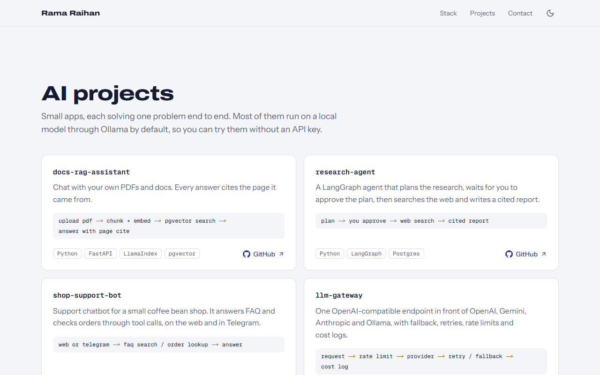

# ramaraihan12.github.io

Live at **https://ramaraihan12.github.io**

My personal site. One page that says who I am, what I work with and what I've built, with the AI projects first because that's what I'm spending my time on now.

<p>
  
  
</p>

## How it works

- One page, exported to plain HTML and CSS at build time (`output: "export"`). No server, no database, no client-side fetching.
- All the text lives in `src/content/`. Adding a project means adding one object to `projects.ts`, nothing else.
- Dark mode follows the system until you pick one with the toggle. A small inline script sets the class before first paint, so the page never flashes the wrong theme.
- Motion is CSS only. The hero rises in on load and project cards fade in as they scroll into view. Both switch off with `prefers-reduced-motion`, and browsers without scroll-driven animations just show the cards.
- The Open Graph card is drawn from my photo with `next/og` at build time and saved as `og.png`. It's a route handler rather than `opengraph-image.tsx`, because the static export writes that one out without a file extension and GitHub Pages would serve it as a download.

## Stack

- Next.js 16 (App Router), React 19, TypeScript
- Tailwind CSS 4
- `next/font` with Archivo, Instrument Sans and Geist Mono

## Run it

Needs Node 20.9 or newer (I use 24).

```bash
npm ci
npm run dev
```

Then open http://localhost:3000.

To check the real output, build it and serve the `out/` folder:

```bash
npm run build
npx serve@14 out
```

No env vars. The public URL used for the canonical link, Open Graph tags and sitemap is in `src/content/site.ts`, next to the rest of the content.

## Checks

```bash
npm run lint && npm run build
```

There's no test suite, it's static content. The build type-checks everything, and CI runs the same two commands on every push and pull request.

## Deploy

`.github/workflows/pages.yml` builds the site and publishes `out/` to GitHub Pages on every push to `main`. In the repo settings, Pages has to be set to deploy from GitHub Actions. Since the build is just static files, any other static host works too.

## Notes

- No CMS on purpose. The content changes a few times a year, and a TypeScript file is easier to review than a dashboard.
- There's no image optimization on a static host, so the one photo in `public/images/` is resized by hand to what the page needs.
- The project list is hand-written, not pulled from the GitHub API. Repo descriptions are often too short to explain what a project does, and I'd rather not hit a rate limit on build.
- Next I'd like to add a short write-up per AI project (what broke, what I'd do differently) and a Bahasa Indonesia version of the page.

## License

MIT
