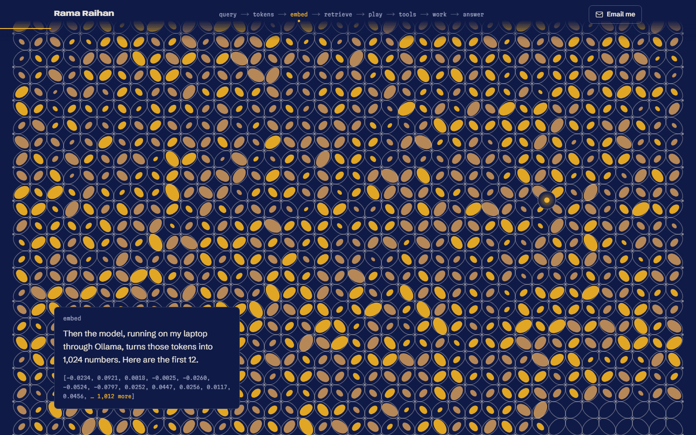
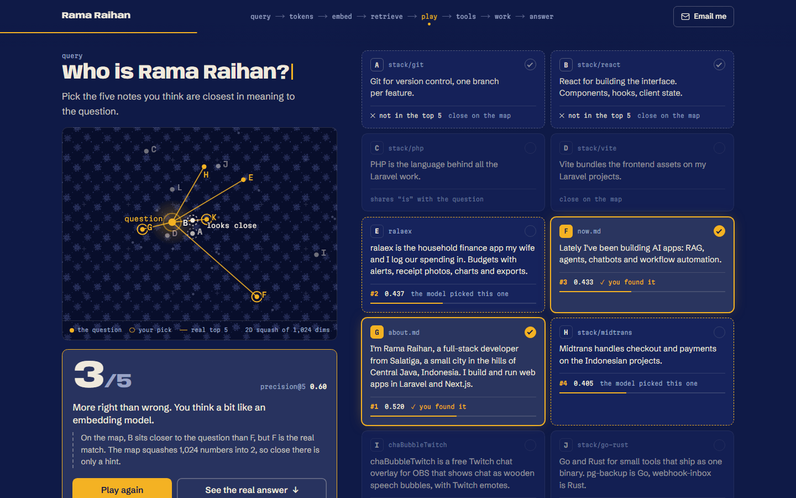
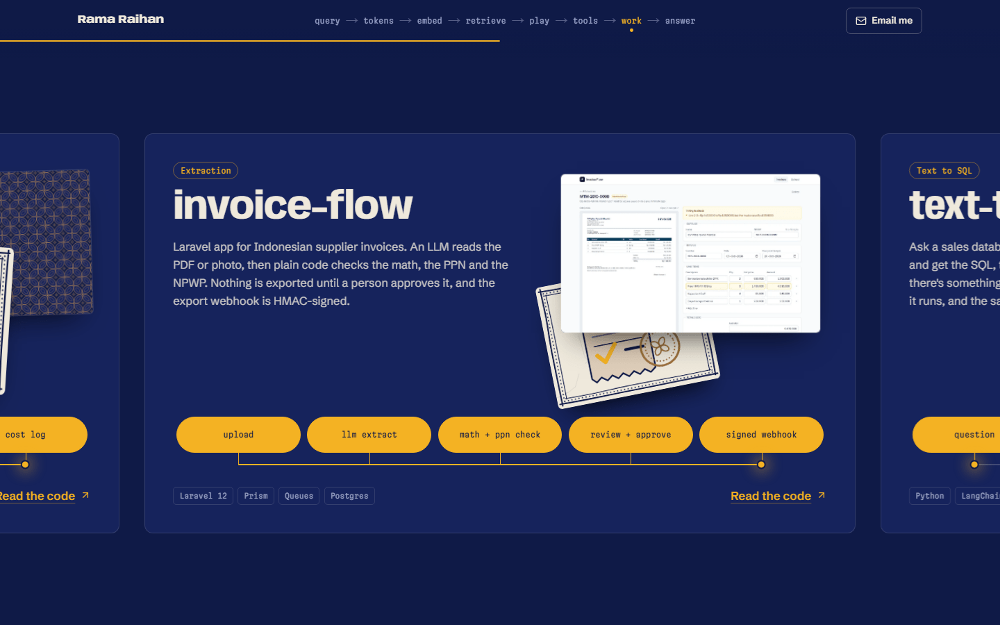
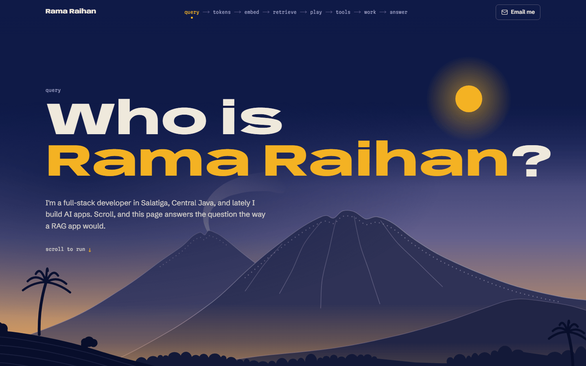
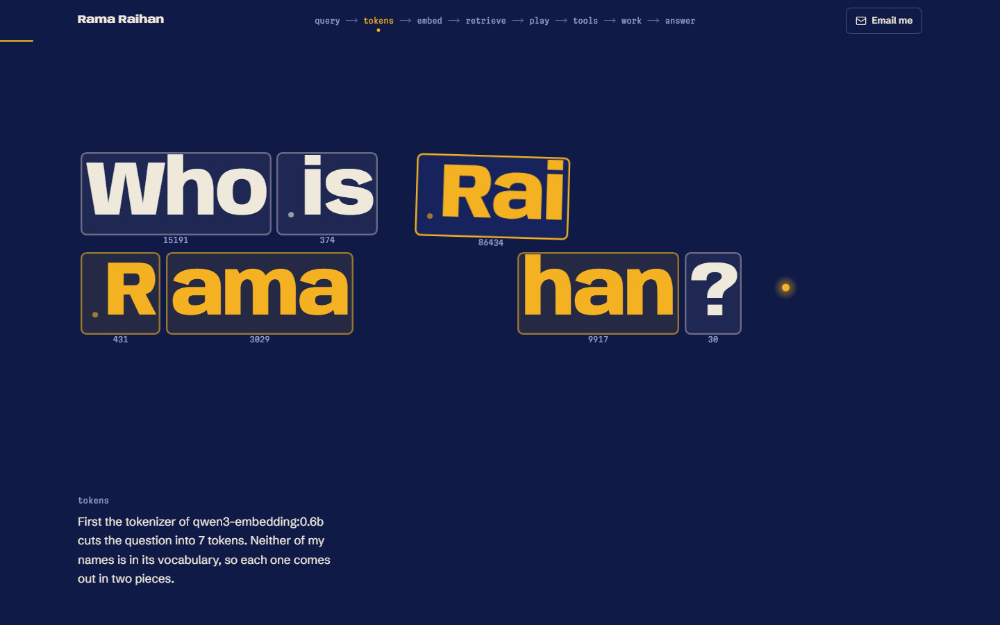
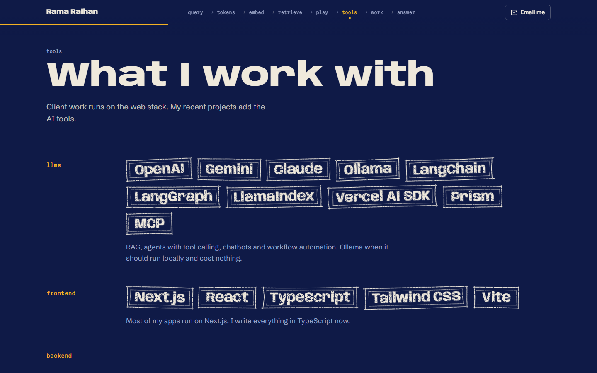
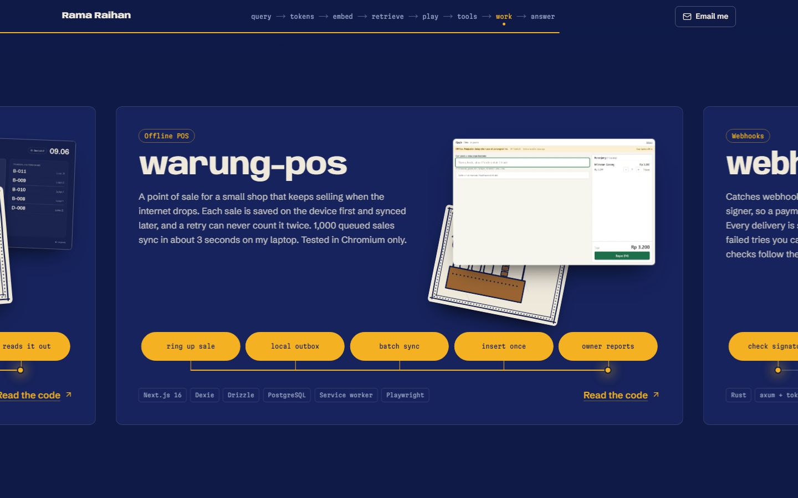
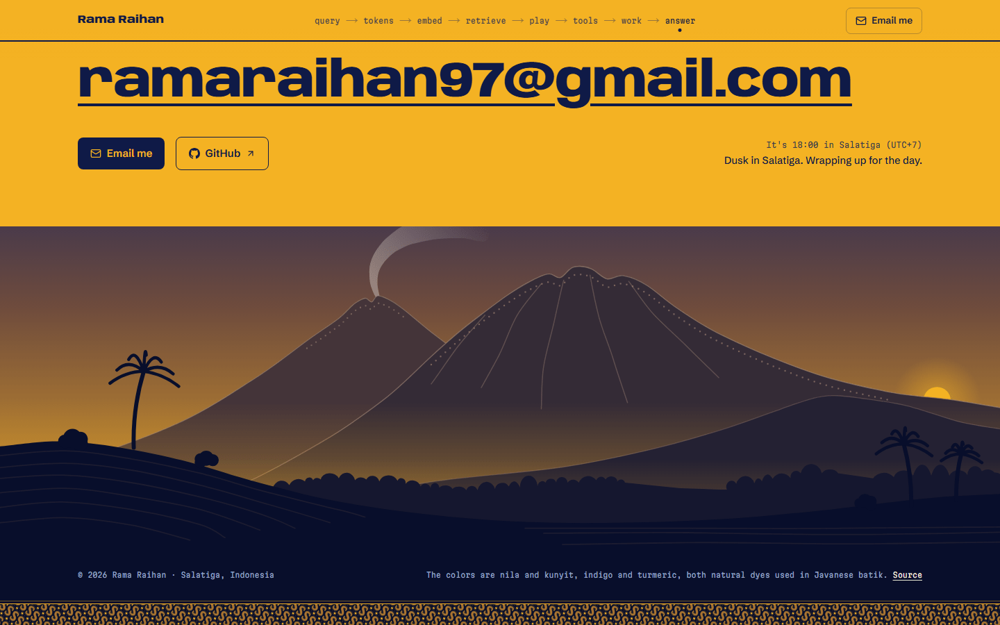

# ramaraihan12.github.io

Live at **https://ramaraihan.is-a.dev**

My personal site. It answers one question, "Who is Rama Raihan?", the way a RAG app would. As you scroll, the question gets tokenized, turned into an embedding, matched against short notes I wrote about myself, and answered with citations. Along the way there's a small game, my stack, and the things I've built. It's drawn like batik, in indigo and turmeric, and some of the patterns are made from the real data.

<p>
  
</p>

<p>
  
  
</p>
<p>
  
  
</p>
<p>
  
  
</p>

<details>
<summary>More screenshots</summary>
<p>
  
  
</p>
<p>
  
  
</p>
<p>
  
</p>
</details>

## What's real and what isn't

- The token IDs come from the embedding model's own tokenizer (`Qwen/Qwen3-Embedding-0.6B` on Hugging Face). Neither of my names is in its vocabulary, so both get split in two.
- The numbers, the scores and the map come from `qwen3-embedding:0.6b`, run on my laptop through Ollama. `scripts/embed_notes.py` embeds the 51 notes in `scripts/notes.json`, ranks them by cosine similarity, and squashes everything to 2D with PCA. The page reads the result from `src/content/retrieval.json`.
- The kawung cloth is the question's whole embedding, saved in the same file as `queryVector`. Each of the 1,024 numbers is one petal: the bigger the number, the more dye, turmeric if it's positive and soga brown if it's negative. The grid has a few more slots than that, and those stay bare wax.
- The map is a PCA squash of 1,024 dimensions into 2, so dots that look close may not be close in meaning. The ranking uses all 1,024.
- Each note gets a one-line header with my name before it's embedded. Without it, notes like "I deploy my own apps..." don't say whose they are, and they lose to random stack notes.
- When I added notes for the newer projects, I embedded all 51 again, so every score and dot on the page comes from one run.
- Nearest Neighbors deals the real top five plus seven decoys, and scores your picks against the real top five. The decoys are there to tempt you: close on the map, in the same group as a real match, or sharing a word with the question. When a decoy sits closer on the map than a real match, the game says so.
- The answer at the end is not generated. I wrote it from the five notes that came back.
- The sky at the bottom follows the real time in Salatiga.
- All the art is drawn in code, as SVG and canvas. No image generators. The only image files are my photo and the project screenshots, taken from each repo's docs.

## How it works

- One page, exported to plain HTML, CSS and JS at build time (`output: "export"`). No server, no database, nothing fetched at runtime.
- The header is the pipeline: `query → tokens → embed → retrieve → play → tools → work → answer`. It lights up the stage you're at, and clicking one scrolls to it, including stages inside a pinned scene. On a phone it shows only the current stage.
- The scenes are GSAP ScrollTrigger timelines scrubbed by the scroll position, with Lenis for smooth scrolling. They live in `src/components/scenes/`: `opening` is the question, tokens, cloth and map in one pinned scene, `middle` has the tool stamps and the sideways work rail, and `closing` has the answer and the sky.
- The art kit is in `src/components/art/`: the batik patterns (kawung, parang, truntum), Merbabu and Merapi, the sky by the hour, the kawung cloth, a postcard per project, the photo frame, the duotone filter and the cap stamps. It's all decoration and hidden from screen readers. The meaning stays in the text.
- The landscape is drawn at build time, so its shapes ship as SVG markup, not JavaScript. The map and the cloth are canvases that only redraw while their scene is on screen.
- The token chips can be picked up and thrown while the question is in pieces, and a small spring pulls them back. On a phone, a vertical swipe still scrolls the page.
- The game is its own chunk. It's fetched when its section is a screen away and only runs when you press Play.
- The extras: achievement toasts (each one shows once), batik mode with the Konami code or seven quick taps on my name, and a note in the browser console that answers `rama.hello()`. Only their listeners load with the page. The toast and the dye load the first time they're needed.
- Every scene is a normal document underneath. A small inline script adds a `scrolly` class to `<html>` before first paint when motion is allowed, and the pinned layouts hang off that class. With reduced motion, or if the scripts never load, you get the same content top to bottom without the animation.
- The words live in `src/content/`: `copy.ts` has the headings, buttons, toasts and the console note, `story.ts` has the stages, the intro and the answer, and then there's `projects.ts` and `stack.ts`. Counts are read from the data, so a heading can't say "eight" when there are nine. Adding a project means adding one object to `projects.ts`.
- The styles are split by area in `src/styles/`, one file per part of the page. `globals.css` imports them in page order, which is also the cascade order.
- The Open Graph card is drawn with `next/og` at build time and saved as `og.png`: the question over Merbabu, with a turmeric sun. It's a route handler rather than `opengraph-image.tsx`, because the static export writes that one out without a file extension and GitHub Pages would serve it as a download.

## Stack

- Next.js 16 (App Router), React 19, TypeScript
- Tailwind CSS 4
- GSAP 3 with ScrollTrigger and `@gsap/react`, and Lenis. No other GSAP plugins: the chip drag is a small spring written by hand.
- `next/font` with Anybody (its width axis is animated in a few places), Schibsted Grotesk and Martian Mono
- Python, Ollama and Hugging Face `tokenizers` for the retrieval data, only at authoring time

## Run it

Needs Node 20.9 or newer (I use 24).

```bash
npm ci
npm run dev
```

Then open http://localhost:3000.

To check the real output, build it and serve the `out/` folder:

```bash
npm run build
npx serve@14 out
```

No env vars. The public URL used for the canonical link, Open Graph tags and sitemap is in `src/content/site.ts`.

## Update the notes

Edit `scripts/notes.json`, then rebuild the retrieval data. You need Ollama running with the embedding model pulled:

```bash
ollama pull qwen3-embedding:0.6b
uv run scripts/embed_notes.py
```

It rewrites `src/content/retrieval.json`: the tokens, the scores, the map, and the question's whole vector (`queryVector`) that the cloth is drawn from. It prints the new top five. If they change, update the answer in `src/content/story.ts` so its citations still match. The game and the counts on the page follow the new data by themselves.

## Checks

```bash
npm run lint && npm run build
```

There's no test suite, it's a static page. The build type-checks everything, and CI runs the same two commands on every push and pull request. The sky has a small check of its own, for its colors through the day:

```bash
npx tsx src/components/art/sky.check.ts
```

## Deploy

`.github/workflows/pages.yml` builds the site and publishes `out/` to GitHub Pages on every push to `main`. In the repo settings, Pages has to be set to deploy from GitHub Actions.

## Notes

- The two main colors are nila and kunyit, indigo and turmeric, both natural dyes used in Javanese batik. Indigo is the page, turmeric is your query: the dot, the lines it draws, and the answer it fills the screen with. The art adds soga brown, mori (the plain cotton) and malam (the wax, darker than the page).
- No CMS on purpose. The content changes a few times a year, and a TypeScript file is easier to review than a dashboard.
- The project list is hand-written, not pulled from the GitHub API. Repo descriptions are often too short to explain what a project does.
- Next I'd like a Bahasa Indonesia version of the page.

## License

The code is MIT, so take whatever helps. My photo and the written content (bio, notes and project write-ups) aren't covered by it, so please don't reuse those.
