# ramaraihan12.github.io

Live at **https://ramaraihan.is-a.dev**

My personal site. It answers one question, "Who is Rama Raihan?", the way a RAG app would. As you scroll, the question gets tokenized, turned into an embedding, matched against short notes I wrote about myself, and answered with citations. Along the way there's a small game, my stack, and the things I've built, and a thread of wax runs down the left side from the map to the answer. It's drawn like batik, in indigo and turmeric, and some of the patterns are made from the real data.

<p>
  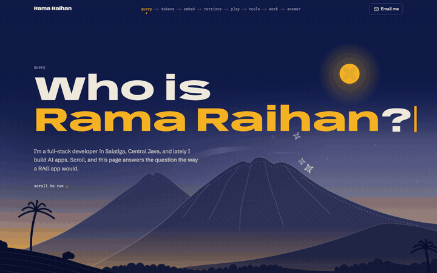
</p>

<p>
  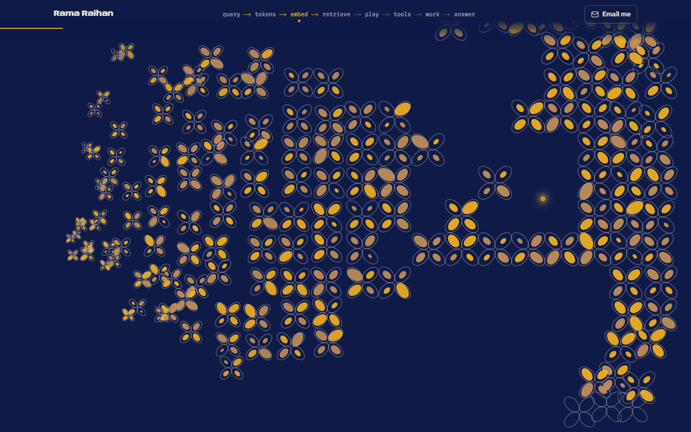
  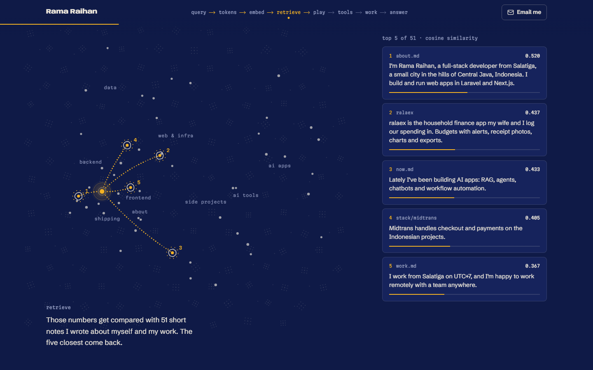
</p>
<p>
  
  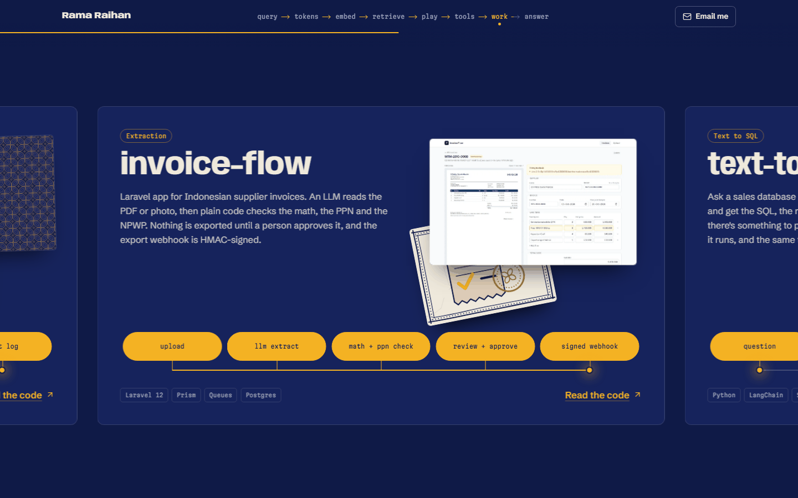
</p>
<p>
  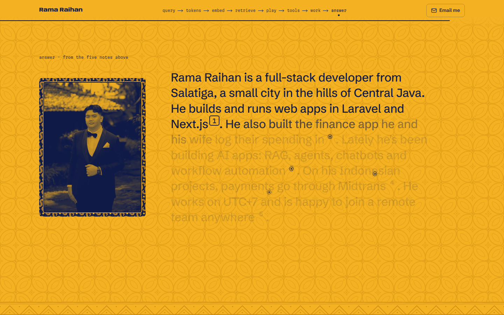
  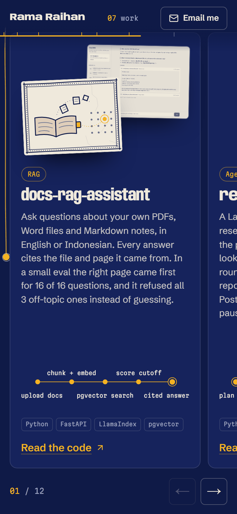
</p>

<details>
<summary>More screenshots</summary>
<p>
  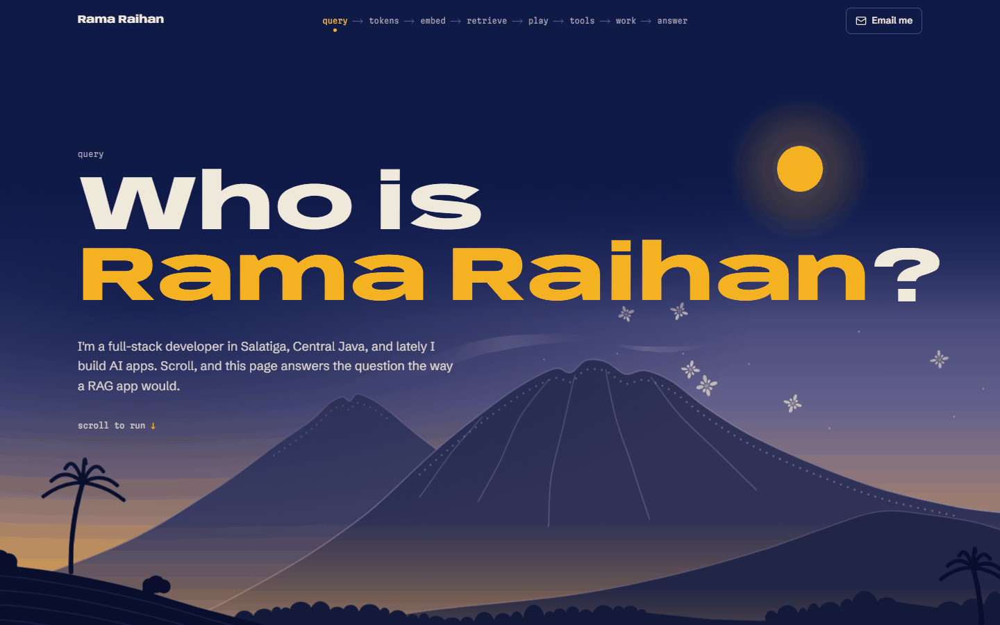
  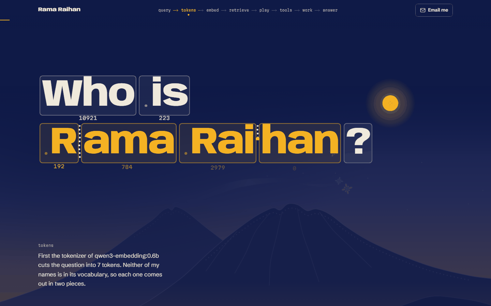
</p>
<p>
  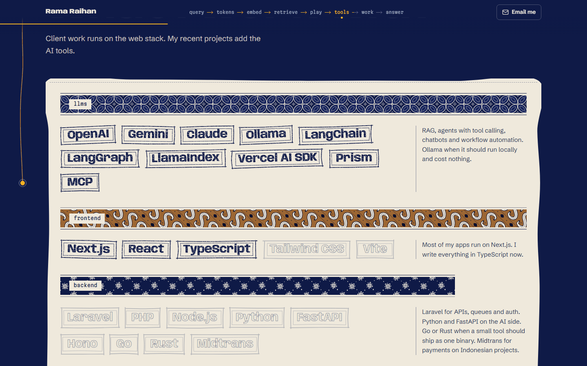
  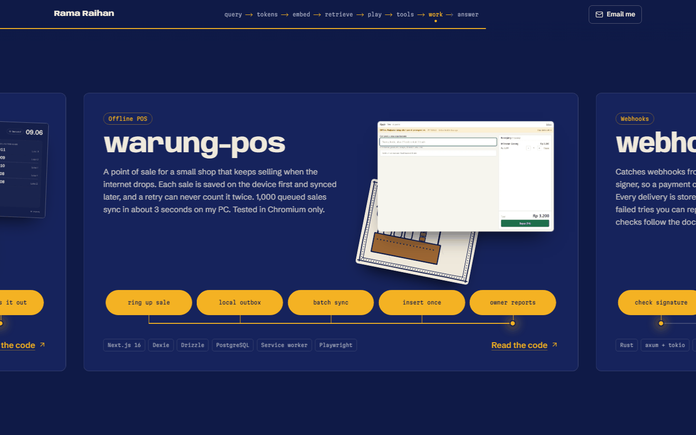
</p>
<p>
  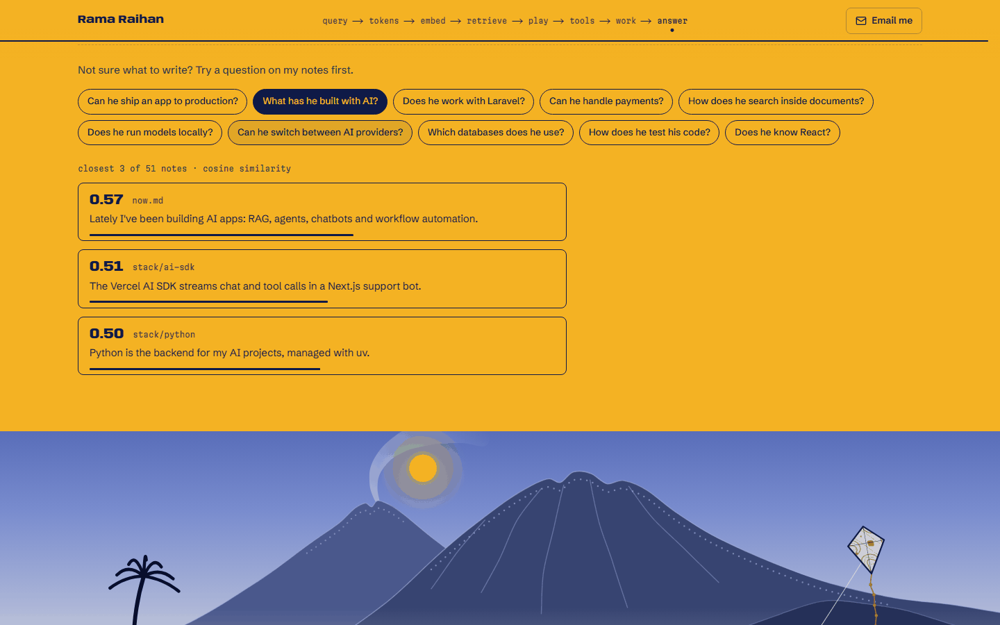
</p>
</details>

## What's real and what isn't

- The token IDs come from the embedding model's own tokenizer (`Qwen/Qwen3-Embedding-0.6B` on Hugging Face). Neither of my names is in its vocabulary, so both get split in two.
- The numbers, the scores and the map come from `qwen3-embedding:0.6b`, run on my PC through Ollama. `scripts/embed_notes.py` embeds the 51 notes in `scripts/notes.json`, ranks them by cosine similarity, and squashes everything to 2D with PCA. The page reads the result from `src/content/retrieval.json`.
- The kawung cloth is the question's whole embedding, saved in the same file as `queryVector`. Each of the 1,024 numbers is one petal: the bigger the number, the more dye, turmeric if it's positive and soga brown if it's negative. The grid has a few more slots than that, and those stay bare wax.
- The map is a PCA squash of 1,024 dimensions into 2, so dots that look close may not be close in meaning. The ranking uses all 1,024.
- Each note gets a one-line header with my name before it's embedded. Without it, notes like "I deploy my own apps..." don't say whose they are, and they lose to random stack notes.
- When I added notes for the newer projects, I embedded all 51 again, so every score and dot on the page comes from one run.
- Closer shows one question and two of my notes, and you pick the one the model scores closer. Both scores are real cosine similarities from the same model. `scripts/embed_closer.py` embeds ten questions, scores my notes against each one, and writes the result to `src/content/closer.json`. In `src/components/game/rounds.ts` the gap between the two scores shrinks as your streak grows, the early pairs turn on the question itself rather than on notes the model scores high for almost anything, and in the late ones the closer note is one of its best matches. Some pairs are traps where the lower note shares a word with the question. The model goes by meaning, so the shared word doesn't save it. The question changes every three pairs, and one wrong call ends the run. When it does, "Save the cloth" turns the cloth you wove into a PNG, drawn in the browser when you press it (on a phone it can open the share sheet).
- The answer at the end is not generated. I wrote it from the five notes that came back.
- The questions under "Ask me something else" were embedded ahead of time, the same ones Closer uses, and scored against the 51 notes. Picking one lists its three closest notes with those real scores. Nothing is sent anywhere.
- The sky at the bottom follows the real time in Salatiga. By day a layangan, a paper kite, flies over Merbabu. After dark it lies on the hill.
- All the art is drawn in code, as SVG and canvas. No image generators. The only image files are my photo and the project screenshots, taken from each repo's docs.

## How it works

- One page, exported to plain HTML, CSS and JS at build time (`output: "export"`). No server, no database, nothing fetched at runtime.
- The header is the pipeline: `query → tokens → embed → retrieve → play → tools → work → answer`. It lights up the stage you're at, and clicking one scrolls to it, including stages inside a pinned scene. The arrows between the stages work like a wire: the ones behind you are inked and the next one fills as you scroll through the stage you're in. On a phone it shows only the current stage, and the progress bar has a tick where each stage starts.
- The scenes are GSAP ScrollTrigger timelines scrubbed by the scroll position, with Lenis for smooth scrolling. They live in `src/components/scenes/`: `opening` is the question, tokens, cloth and map in one pinned scene, `middle` has the tools cloth and the work section, and `closing` has the answer, the "ask me something else" picker and the sky. The game and the thread have their own folders.
- The art kit is in `src/components/art/`: the batik patterns (kawung, parang, truntum), Merbabu and Merapi, the sky by the hour, the layangan, the kawung cloth, a postcard per project, the photo frame, the duotone filter, the cap stamps, and the helpers that draw paths by hand from a seeded random. It's all decoration and hidden from screen readers. The meaning stays in the text.
- The landscape is drawn at build time, so its shapes ship as SVG markup, not JavaScript. The map and the cloth are canvases that only redraw while their scene is on screen.
- In the tokens step a canting, the pen that draws wax, cuts the question where the tokenizer cut it, and the ids count up. When the cloth is done it comes apart and its flowers fly out to the notes on the map. At the answer, five rings fly from the notes into the citations, and a citation and its source light each other up when you hover or focus either.
- The tools section is a cap sampler: a scrap of cloth with a band of batik for each group, and the tool names pressed on like cap stamps as you scroll.
- Work is a sideways rail of project panels on a wide screen. On a phone it's a swipe deck: CSS scroll snapping, one card at a time, a counter like 01 / 12 and two arrow buttons. A small script only keeps the counter and the buttons in step. Each card's art is built when you get near it, and turning the phone keeps the project you were reading.
- The thread is called Benang, Indonesian for thread. The query dot leaves the map as a drip of wax dots that set into a thread down the left margin, and the dot rides it past the game, the tools and the work, then lands as the seed of the answer. Its code, and the one GSAP plugin it needs, load once the scenes are up, and it reads positions when the page is measured, not on every scroll frame. With reduced motion, or on a screen too short to pin, the thread is drawn whole with no dot.
- The token chips can be picked up and thrown while the question is in pieces, and a small spring pulls them back. On a phone, a vertical swipe still scrolls the page.
- The game is its own chunk. It's fetched when its section is a screen away and only runs when you press Play.
- The extras: achievement toasts (each one shows once), batik mode with the Konami code or seven quick taps on my name, a note in the browser console that answers `rama.hello()`, and a tab title that reads "paused at <stage>" while the tab is hidden. Only their listeners load with the page. The toast and the dye load the first time they're needed.
- My email address is a copy button. In the contact section a cap stamp saying copied is pressed next to it.
- The 404 page is a blank cloth. Draw on it in wax, press Dip, and the dye takes everywhere except under the wax. It loads on that page only, so the home page doesn't carry it.
- Every scene is a normal document underneath. A small inline script adds a `scrolly` class to `<html>` before first paint when motion is allowed, and the pinned layouts hang off that class. With reduced motion, or if the scripts fail to load, you get the same content top to bottom without the animation. A slow phone isn't counted as a failure, so it keeps the animated layout and waits for the scripts.
- A link to `/#work` or `/#contact` lands where the nav would, a reload puts you back where you were, and turning the phone keeps your place. That logic is in `src/lib/`: `scroll.ts` has the engine and the media queries, `stage.ts` tracks the stage and places you on load, and `keep-place.ts` handles rotating and resizing.
- The words live in `src/content/`: `copy.ts` has the headings, buttons, toasts and the console note, `story.ts` has the stages, the intro and the answer, and then there's `projects.ts` and `stack.ts`. The words only one part uses, like the game, the 404 page and the swipe deck, sit next to that part. Counts are read from the data, so a heading can't say "eight" when there are nine. Adding a project means adding one object to `projects.ts`.
- The styles are split by area in `src/styles/`, one file per part of the page. `globals.css` imports them in page order, which is also the cascade order.
- The Open Graph card is drawn with `next/og` at build time and saved as `og.png`: the question over Merbabu, with a turmeric sun. It's a route handler rather than `opengraph-image.tsx`, because the static export writes that one out without a file extension and GitHub Pages would serve it as a download.

## Stack

- Next.js 16 (App Router), React 19, TypeScript
- Tailwind CSS 4
- GSAP 3 with ScrollTrigger, MotionPathPlugin (only for the thread) and `@gsap/react`, and Lenis. No other GSAP plugins: the chip drag is a small spring written by hand.
- `next/font` with Anybody (its width axis is animated in a few places), Schibsted Grotesk and Martian Mono
- Python, Ollama and Hugging Face `tokenizers` for the retrieval and game data, only at authoring time

## Run it

Needs Node 20.9 or newer (I use 24).

```bash
npm ci
npm run dev
```

Then open http://localhost:3000.

To check the real output, build it and serve the `out/` folder:

```bash
npm run build
npx serve@14 out
```

No env vars. The public URL used for the canonical link, Open Graph tags and sitemap is in `src/content/site.ts`.

## Update the notes

Edit `scripts/notes.json`, then rebuild the data. You need Ollama running with the embedding model pulled:

```bash
ollama pull qwen3-embedding:0.6b
uv run scripts/embed_notes.py
uv run scripts/embed_closer.py
```

`embed_notes.py` rewrites `src/content/retrieval.json`: the tokens, the scores, the map, and the question's whole vector (`queryVector`) that the cloth is drawn from. It prints the new top five. If they change, update the answer in `src/content/story.ts` so its citations still match. The counts on the page follow the new data by themselves.

`embed_closer.py` rewrites `src/content/closer.json`, the questions and scores Closer deals its pairs from. The "ask me something else" picker lists the same ten questions with their closest three notes, so it needs no step of its own. It prints each question's top five, so you can check that a person would pick the same notes.

## Checks

```bash
npm run lint && npm run build
```

There's no test suite, it's a static page. The build type-checks everything, and CI runs the same two commands on every push and pull request. `npx tsc --noEmit` runs the same type check without a build. The sky has a small check of its own, for its colors through the day, and so do Closer's rules, which deal a few thousand runs and print one to read through:

```bash
npx tsx src/components/art/sky.check.ts
npx tsx src/components/game/rounds.check.ts
```

## Deploy

`.github/workflows/pages.yml` builds the site and publishes `out/` to GitHub Pages on every push to `main`. In the repo settings, Pages has to be set to deploy from GitHub Actions.

## Notes

- The two main colors are nila and kunyit, indigo and turmeric, both natural dyes used in Javanese batik. Indigo is the page, turmeric is your query: the dot, the lines it draws, and the answer it fills the screen with. The art adds soga brown, mori (the plain cotton) and malam (the wax, darker than the page).
- Everything that moves has a reduced-motion version with the same content: the thread is drawn whole and the pinned scenes lay out as plain sections.
- No CMS on purpose. The content changes a few times a year, and a TypeScript file is easier to review than a dashboard.
- The project list is hand-written, not pulled from the GitHub API. Repo descriptions are often too short to explain what a project does.
- Next I'd like a Bahasa Indonesia version of the page.

## License

The code is MIT, so take whatever helps. My photo and the written content (bio, notes and project write-ups) aren't covered by it, so please don't reuse those.
